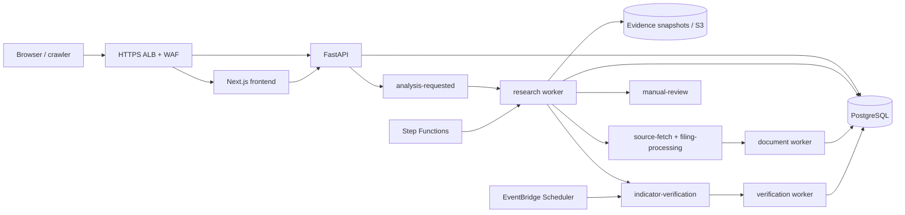

# Benmo

Benmo 是一个“公开记录、持续核验”的产业链因果假设平台。第一版后端把事件事实、候选因果边、证据快照、验证规则和版本历史分开保存；LLM 负责提出与审查假设，确定性规则决定内容是否可以发布。

本仓库包含公开 Next.js 网站、API、异步 worker 和 AWS 部署基础设施。

## 部署方式

不需要准备本地部署环境。生产环境在代码 push 到 `master` 且 CI 全部通过后，由 GitHub
Actions 使用 OIDC 临时 AWS Role 自动构建不可变 ECR 镜像并部署。需要配置的主要内容是 AWS Role ARN、OpenAI
API Key、ACM 证书、公开站点 URL 和 SEC User-Agent；完整一次性准备与运行步骤见
[自动部署手册](docs/deployment.md)。

## 运行结构



生产 CDK 栈创建：

- 双可用区 VPC，ALB 位于公有子网，ECS 位于私有应用子网，RDS 位于隔离子网；
- 加密、Multi-AZ 的 RDS PostgreSQL，私有且启用备份、删除保护与 Performance Insights；
- 私有且版本化的 S3、六组 SQS + DLQ；
- Next.js SSR 前端与 API 常驻 Fargate 服务，以及从 0 按队列扩容的一次性 worker；
- Analysis/Verification 两个 Standard Step Functions 工作流；
- EventBridge Scheduler group、Secrets Manager、CloudWatch dashboard/alarms；
- 挂载在 ALB 上的 WAF；暂不包含用户注册、登录或账户验证；
- HTTPS-only 公共入口（HTTP 仅 301 跳转）。

## 供应商配置

第一版可以直接采购与接入的分层如下；所有 provider 都通过适配器和环境变量隔离，业务代码不应直接依赖某一家 SDK。

| 能力 | 第一版 | 升级方案 |
| --- | --- | --- |
| LLM 推理 | OpenAI | 多模型审核 |
| 网页检索 | 模型自带 Web Search | Bigdata + Web Search |
| 新闻候选 | Finnhub、Alpha Vantage | Bigdata / RavenPack |
| 公司事件 | Finnhub / SEC | Aiera |
| 财报 Transcript | SEC / 网页搜索 | Quartr 或 Aiera |
| 财务数据 | Alpha Vantage / Fiscal | S&P / Fiscal 企业版 |
| 商品数据 | Alpha Vantage、官方 API | 专业商品数据商 |
| 经济数据 | FRED / BLS / BEA / EIA | 机构数据源 |
| 公司实体补充 | 自建 + LLM | Bigdata / AlphaLens |
| 股价数据 | Alpha Vantage / Finnhub | 商业行情 API |

变量清单见 [.env.example](.env.example)，采购与密钥管理见 [docs/provider-configuration.md](docs/provider-configuration.md)。生产 API Key 由 GitHub Actions 写入 Secrets Manager；启用 provider 前必须通过配额、归档许可和 SEC User-Agent 检查。

## 生产部署

在 GitHub 配置已有 OIDC Deployment Role 的 `AWS_DEPLOY_ROLE_ARN` 与 Provider API Key。
之后 push `master` 会自动执行测试、ECR 镜像发布、CDK 部署、数据库迁移和健康检查。完整步骤见
[docs/deployment.md](docs/deployment.md)。

## 常用检查

```powershell
# API / worker Python 检查（各项目安装 dev 依赖后）
python -m ruff check benmo-backend benmo-worker
python -m pytest benmo-backend benmo-worker

# 前端检查
npm --prefix benmo-frontend run lint
npm --prefix benmo-frontend run typecheck
npm --prefix benmo-frontend test
npm --prefix benmo-frontend run build

# CDK 类型检查与 CloudFormation 合成
.\dev.ps1 infra-check
.\dev.ps1 infra-synth
```

Pull Request CI 会执行 backend、worker 与 frontend 的检查，构建三个 Docker 镜像，并
synth CDK；`master` push 通过全部检查后自动部署。目录说明：

- `benmo-frontend/`：Next.js App Router 公开网站、实时分析进度和因果图；
- `benmo-backend/`：FastAPI 模块化单体、数据库模型和 API；
- `benmo-worker/`：研究、文档、核验 worker 和严格 JSON stage CLI；
- `infra/`：AWS CDK TypeScript 生产栈；
- `docs/`：采购配置和生产运行手册。
